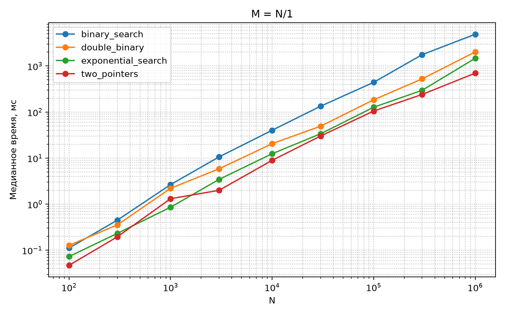
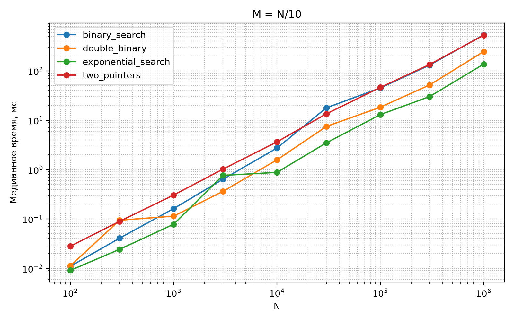
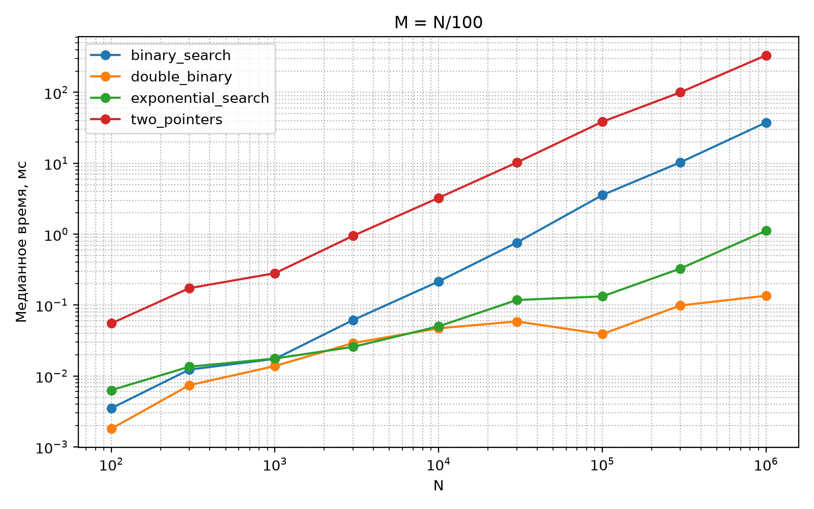

# Лабораторная работа

Наличие общего элемента в двух отсортированных массивах.

## Алгоритмы

| Алгоритм | Время | Память |
|---|---|---|
| Два указателя | `O(M+N)` | `O(1)` |
| Бинарный поиск | `O(min(M,N)*log max(M,N))` | `O(1)` |
| Экспоненциальный | `O(M*log(2N/M))` | `O(1)` |
| Двойной бинарный | `O(M*log(2N/M))` | `O(log M)` |

## Графики

### Массивы одинакового размера (M = N)

### Один массив в 10 раз короче (M = N/10)

### Один массив в 100 раз короче (M = N/100)

## Выводы

**Примечание**: Двойной бинарный поиск теоретически эффективен, но в Питоне (из-за накладных расходов на вызовы рекурсивной функции и создания фреймов стека) он проигрывает экспоненциальному поиску.

### Для `M ≈ N`
Самым эффективным алгоритмом являются Два указателя. При `M = N` время выполнения двух указателей, экспоненциального и двойного бинарного поиска равно `O(N)` (`O(M*log(2N/M))=O(N*log 2`=`O(N)`), бинарный поиск: `O(N*logN)`, самый худший, что видно по графику. 

Экспоненциальный и двойной бинарный поиски проигрывают двум указателям, так как у двух указателей минимальные накладные расходы и нет рекурсии.

### Для `M < N`
Экспоненциальный поиск является самым эффективным, если один массив в 10 раз короче другого. Двойной бинарный поиск тоже эффективен, но выполняется медленнее.

Бинарный поиск на значениях `N<10^3` эффективен, как и двойной бинарный, однако при всё больших значениях `N` бинарный поиск по скорости выполнения приближается к двум указателям, так как порядок количества операций начинается совпадать (например, при `N = 1_000`: два указателя: `1_100` операций, бинарный поиск: `690` операций против `N = 1_000_000_000`: два указателя: `1_100_000_000` операций, бинарный поиск: около `2_070_000_000` операций).

Два указателя - самый неэффективный, так как иные алгоритмы кратно быстрее.

### Для `M << N/100`
Два указателя самый неэффективный алгоритм из-за перебора каждого элемента.

Экспоненциальный и двойной бинарный поиски являются самыми эффективными за счёт галопирования и поиска от предыдущей найденной позиции, в отличие от стандартного бинарного поиска.
