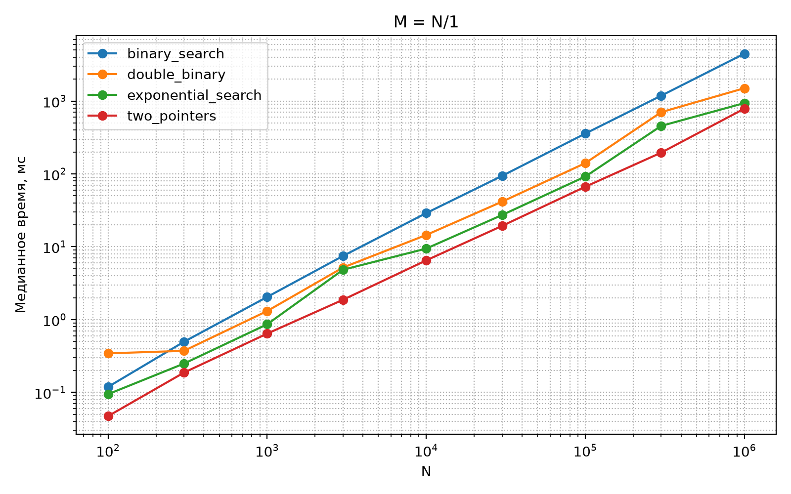
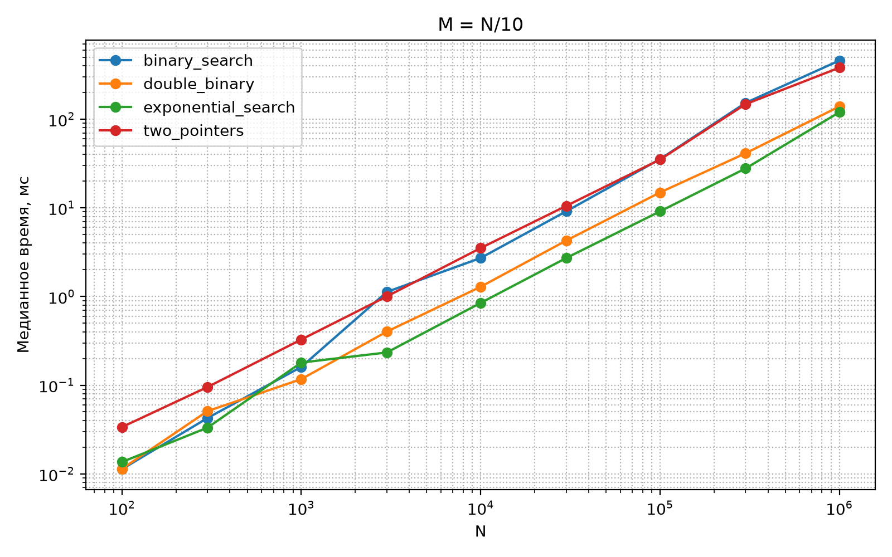
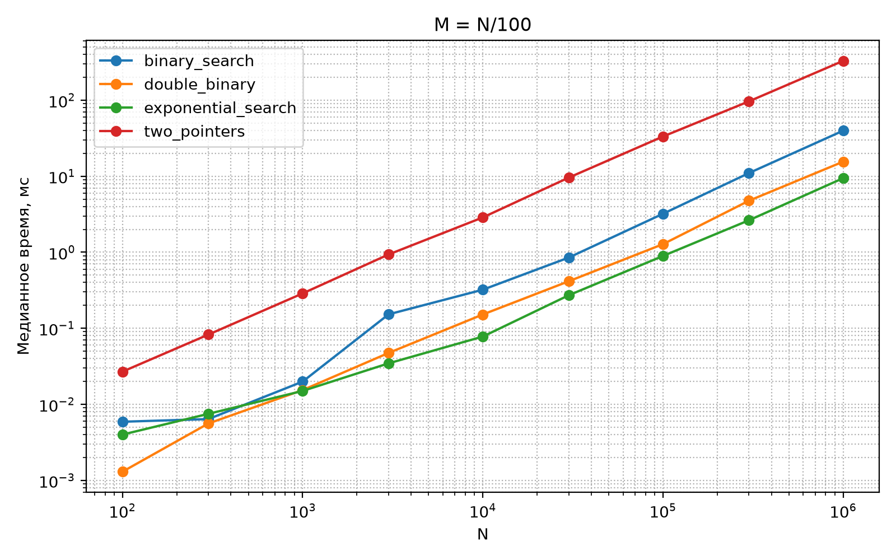

# Лабораторная работа

Наличие общего элемента в двух отсортированных массивах.

## Алгоритмы

| Алгоритм | Время | Память |
|---|---|---|
| Два указателя | `O(M+N)` | `O(1)` |
| Бинарный поиск | `O(min(M,N)*log max(M,N))` | `O(1)` |
| Экспоненциальный | `O(M*log(2N/M))` | `O(1)` |
| Двойной бинарный | `O(M*log(2N/M))` | `O(log M)` |

## Графики

### Массивы одинакового размера (M = N)

### Один массив в 10 раз короче (M = N/10)

### Один массив в 100 раз короче (M = N/100)

## Выводы

1. При сильно различающихся размерах (`M << N`, например `N/100`) наиболее эффективен экспоненциальный поиск. Он работает быстрее обычного бинарного за счет того, что начинает поиск с предыдущей найденной позиции, а не с начала. Способ двух указателей в этом случае становится самым медленным, так как вынужден делать `O(N)` шагов.

2. При одинаковых размерах (`M ≈ N`) побеждают два указателя. У него минимальные накладные расходы и нет рекурсии. Бинарный поиск в этом случае показывает худший результат.

3. Двойной бинарный поиск теоретически эффективен, но в Питоне (из-за накладных расходов на вызовы рекурсивной функции и создания фреймов стека) он проигрывает экспоненциальному поиску.
